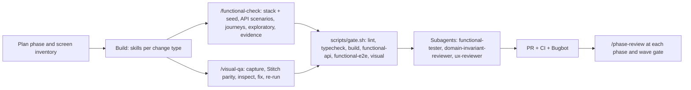

# BudgetFlow AI harness

BudgetFlow is built by Cursor agents. The harness gives every agent the same context, procedures, guardrails, verification and evidence, from Phase 1 (architecture and the accounting-grade domain) to Phase 20 (final report).

## How work flows

1. **Plan.** Work comes from the build plan (20 phases, 7 waves). Each task names the files it owns. Screens are built only after their Stitch designs are approved.
2. **Build.** Skills hold the procedure per change type: `api-endpoint` (contract first), `db-migration` (Drizzle + RLS), `ledger-change`, `domain-change`, `integration-adapter`, `ai-feature-guardrails`, `add-feature-screen`.
3. **Prove it works.** The definition of done is functional: `/functional-check` starts the Compose stack (Postgres, Keycloak, Mailpit, MinIO, API, worker, web) with the deterministic seed, runs API scenarios in `apps/api-e2e` and journeys in `apps/web-e2e` as the relevant roles, explores the flow with browser tools, checks Mailpit and the worker, writes evidence, and loops through fixes (max 5). Unit tests are not required. Every invariant maps to a scenario in `docs/testing/invariant-scenarios.md`. The core acceptance scenario runs at every wave gate from Wave 2.
4. **See and fix the UI.** `/visual-qa` captures every screen state at desktop, tablet and mobile in the light theme (dark theme deferred), captures the full page height (the shell scrolls an inner container, so the capture grows the viewport to it), flags console errors, failed requests, overflow (including inside the page scroller and tables clipped by their card), template leftovers and layout shift (shifts within 500 ms of scripted input are excluded, as in CLS), builds side-by-sides with the approved Stitch export, and the agent opens every image, fixes, and re-runs until nothing blocking remains (max 5). Visual regression baselines run in the pinned Playwright image.
5. **Gates.** `scripts/gate.sh` runs exactly what CI runs and skips steps whose projects do not exist yet.
6. **Review and ship.** Subagents review independently; `pr-workflow` opens the PR; CI and Bugbot check it; `/phase-review` assembles the evidence pack.

## Inventory

| Area                | Files                                                                                                                                                                 | Purpose                                                                                                                                                                                       |
| ------------------- | --------------------------------------------------------------------------------------------------------------------------------------------------------------------- | --------------------------------------------------------------------------------------------------------------------------------------------------------------------------------------------- |
| Agent instructions  | `AGENTS.md`; area guides in `docs/ai-harness/agents-md/` (installed by `scripts/install-agents-md.sh`)                                                                | Product, stack, layout, commands, golden rules, definition of done                                                                                                                            |
| Always-on rule      | `.cursor/rules/00-core.mdc`                                                                                                                                           | Scope, secrets, public repo, product integrity, functional definition of done                                                                                                                 |
| Domain rules        | `domain-invariants.mdc`, `ledger-accounting.mdc`, `audit-trail.mdc`, `rules-engine-approvals.mdc`                                                                     | Buckets, periods, reversals, currency triplet, intercompany, DoA, hygiene, contribution requests                                                                                              |
| Engineering rules   | `api-nestjs.mdc`, `contracts.mdc`, `db-drizzle-rls.mdc`, `worker-jobs.mdc`, `integrations.mdc`, `ai-features.mdc`, `infra-local-stack.mdc`                            | Backend conventions                                                                                                                                                                           |
| UI rules            | `frontend-angular.mdc`, `frontend-satori-styling.mdc`                                                                                                                 | Satori-only UI, states, budget-safety visuals, plain-English copy, money formatting                                                                                                           |
| Verification rules  | `testing-functional.mdc`, `testing-visual.mdc`                                                                                                                        | Functional levels, outcomes, evidence, fix loop; visual QA, parity, baselines                                                                                                                 |
| Process rules       | `security.mdc`, `git-worktree-workflow.mdc`, `ci.mdc`, `docs-and-evidence.mdc`, `harness.mdc`                                                                         | Secrets, worktrees, CI, docs and evidence                                                                                                                                                     |
| Skills              | `.cursor/skills/<name>/SKILL.md` (15)                                                                                                                                 | Procedures; every skill is also `/name`                                                                                                                                                       |
| Slash commands      | `.cursor/skills/commands/{gate,new-screen,verify-ui,visual-qa,phase-review,parallel-build}/`                                                                          | Explicit-only skills (`disable-model-invocation: true`) that wrap a full skill                                                                                                                |
| Subagents           | `.cursor/agents/{functional-tester,domain-invariant-reviewer,ux-reviewer,integrator}.md`                                                                              | Independent testing, review and integration                                                                                                                                                   |
| Hooks               | `.cursor/hooks.json`, `.cursor/hooks/*.mjs`, `test-hooks.mjs`                                                                                                         | Block token reads and printing, force-push to main, deletes outside the repo, committing secrets, `drizzle-kit push`; ask before destructive Docker and snapshot updates; format; run summary |
| MCP                 | `.cursor/mcp.json`                                                                                                                                                    | Playwright (exploratory checks), Angular CLI, Nx — pinned                                                                                                                                     |
| Worktrees and cloud | `.cursor/worktrees.json`, `setup-worktree.sh`, `environment.json`, `cloud-install.sh`                                                                                 | Parallel agents and Cloud Agents                                                                                                                                                              |
| Mirrors             | `CLAUDE.md`, `.claude/` (skills, rules, agents, `settings.json`, `hooks/bridge.mjs`), `.agents/skills/`; see [mirrors.md](mirrors.md)                                 | The same harness for Claude Code and the Agent Skills convention, as symlinks into `.cursor/`                                                                                                 |
| Bugbot              | `.cursor/BUGBOT.md`                                                                                                                                                   | Review guidance                                                                                                                                                                               |
| Visual tooling      | `scripts/visual/` (`capture`, `compare`, `design-parity`, `stitch-save`, `self-test`, `pw-docker.sh`, `setup-tools.sh`, `check-baseline-reason.sh`), `design/stitch/` | Visual QA loop, design parity, pinned renders                                                                                                                                                 |
| Scripts             | `scripts/gate.sh`, `stack.sh`, `secret-scan.sh` (+ `secret-patterns.mjs`), `worktree.sh`, `validate-harness.sh`, `install-agents-md.sh`                               | Gates, local stack, secret scan, worktrees, harness validation                                                                                                                                |
| GitHub              | `.github/workflows/ci.yml`, `pull_request_template.md`, `dependabot.yml`, `CODEOWNERS`; `.githooks/`                                                                  | CI, PR format, updates, ownership, git hooks                                                                                                                                                  |
| Templates           | `docs/ai-harness/templates/` (`api-e2e/`, `web-e2e/`, `package-json-additions.json`, `cursorignore`)                                                                  | Copied when Phase 1-2 create the projects                                                                                                                                                     |

## CI

| Job                                  | Runs when                                                       | What                                                                                                                          |
| ------------------------------------ | --------------------------------------------------------------- | ----------------------------------------------------------------------------------------------------------------------------- |
| Harness (token-free)                 | always                                                          | secret scan, harness structure, shellcheck, hook tests, visual tooling self-test, visual-baseline reason check on PRs         |
| Lint, typecheck, build, Satori check | secret + workspace                                              | `scripts/gate.sh static`                                                                                                      |
| Functional                           | secret + workspace + `infra/compose.yaml`                       | `scripts/gate.sh functional` on the Compose stack (MinIO, recorded AI provider); uploads API and journey reports and evidence |
| Visual regression                    | secret + workspace + stack + `apps/web-e2e/visual/screens.json` | `scripts/gate.sh visual` in `mcr.microsoft.com/playwright:v1.64.1-noble`; uploads screenshots, diffs and the HTML report      |

Jobs whose conditions are not met show as skipped, never failed.

## One-time setup

### Local machine

1. Node 24: `nvm install 24`.
2. Registry token: a classic GitHub personal access token with `read:packages` for the `@hylandsoftware` packages, in `~/.npmrc` as `//npm.pkg.github.com/:_authToken=<token>`. It never goes in the repository.
3. `npm install` once (after Phase 1 creates `package.json`); its `prepare` script points git at `.githooks`. Before that: `git config core.hooksPath .githooks`.
4. Docker with Compose; on macOS enable Docker Desktop host networking for the pinned Playwright image.
5. Open the folder in Cursor and trust the workspace (project hooks only run in trusted workspaces). Check Customize, Hooks, and the Hooks output channel.
6. Copy `docs/ai-harness/templates/cursorignore` to `.cursorignore` (agents cannot write that file).

### GitHub repository

1. Repository secret `SATORI_PACKAGES_TOKEN` (Settings, Secrets and variables, Actions): the same kind of token as above. Until it exists, only the harness job runs.
2. The same secret under Dependabot secrets, so npm updates can resolve the private packages.
3. Optional: protect `main` (require PRs and the `Harness (token-free)` check; add the static, functional and visual checks once they run). Enable Bugbot for the repository.

### Cursor Cloud agents (optional)

Add `SATORI_PACKAGES_TOKEN` in the Cursor dashboard (Cloud Agents, Secrets) and create an environment for the repository; it picks up `.cursor/environment.json`.

## Everyday commands

| Need                           | Command                                                                                                                |
| ------------------------------ | ---------------------------------------------------------------------------------------------------------------------- |
| Prove a change works           | `/functional-check`                                                                                                    |
| See and fix the UI             | `/visual-qa <screens>` (one pass without fixes: `/verify-ui`)                                                          |
| Gates                          | `/gate static` while iterating, `/gate` before handing off                                                             |
| New screen                     | `/new-screen <screen>`                                                                                                 |
| Business-rule or ledger change | ask for it; the agent applies `domain-change` / `ledger-change`                                                        |
| Parallel wave                  | `/parallel-build <wave> <scopes>`                                                                                      |
| Phase sign-off                 | `/phase-review <phase-id>`                                                                                             |
| Harness health                 | `sh scripts/validate-harness.sh` (run `sh scripts/visual/setup-tools.sh --with-browser` once for the visual self-test) |

## Extending the harness

- **Rule:** `.cursor/rules/<topic>.mdc` with `description`, `globs`, `alwaysApply: false`; one concern, short, with an example. Add a rule only when agents repeat a mistake.
- **Skill:** `.cursor/skills/<name>/SKILL.md` with `name` equal to the folder and a third-person `description` that says what and when. Explicit-only skills get `disable-model-invocation: true`.
- **Slash command:** a short skill in `.cursor/skills/commands/<command>/` with `disable-model-invocation: true` that points to the full skill. Names must be unique across all skills.
- **Subagent:** `.cursor/agents/<name>.md` with `name`, `description` (say when to use it), `model: inherit`, `readonly: true` for pure reviewers.
- **Hook:** a Node script in `.cursor/hooks/`, an entry in `hooks.json`, and cases in `test-hooks.mjs`. Hooks must always print valid JSON and fail open on internal errors.
- **MCP server:** pinned version, no secrets, `${env:NAME}` for any credential.
- **Mirror:** every new rule, skill and subagent also needs its link under `.claude/` and `.agents/`; `validate-harness` names the missing ones, and [mirrors.md](mirrors.md) gives the commands.
- Finish with `sh scripts/validate-harness.sh`; it also rejects regressions of the project decisions (no throwaway demo or static-site hosting content, no app translations, no unit-test requirement, accessibility checks off, one Playwright version). Deferred: dark theme. The app and every visual check are light theme only for now; `scripts/visual/*` take `--themes light,dark` (or `BF_VISUAL_THEMES`) to re-enable dark later.

## Limits

- Hooks and rules are guardrails for cooperative agents, not a security boundary. Secret detection is pattern-based: `scripts/secret-patterns.mjs` covers the shapes with a recognizable prefix (GitHub, npm, AWS access key ids and Bedrock API keys, Anthropic, Slack, Google, Stripe, JWTs, private keys, credentials in a URL) plus a catch-all for a random-looking value on a variable named TOKEN, SECRET, PASSWORD or KEY. The catch-all needs an unbroken 32-character base64 or hex run, so a key split across lines, assembled from pieces, or short enough to read as a word still gets through. The terminal can still read files that `.cursorignore` hides from the editor.
- `.cursor/commands/` is the legacy slash-command format; Cursor documents skills with `disable-model-invocation: true` as the replacement, so commands here are skills.
- Saving a Stitch export from an MCP result into a file depends on the client storing large tool results as files; otherwise export the PNG from the Stitch web app (`design/stitch/README.md`).
