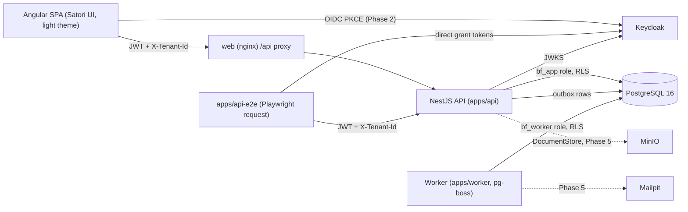

# BudgetFlow architecture

BudgetFlow Enterprise is a multi-tenant corporate budget delegation and control platform. This folder describes what exists after Phase 1 and the conventions later phases extend. Planned work is marked as planned.

| Document                                                               | What it covers                                                                             |
| ---------------------------------------------------------------------- | ------------------------------------------------------------------------------------------ |
| [domain-model.md](domain-model.md)                                     | Entities and tables by area, invariants and where each one is enforced                     |
| [ledger.md](ledger.md)                                                 | Buckets, counter accounts, posting tables, periods, currency triplet, rebuild check        |
| [state-machines.md](state-machines.md)                                 | Budget, commitment, event, request, contribution, period, forecast and recharge lifecycles |
| [authorization.md](authorization.md)                                   | The 14 roles, the action matrix behind `PolicyService.can`, scopes, DoA versus ownership   |
| [api-conventions.md](api-conventions.md)                               | Paths, auth, tenancy, idempotency, problem details, contracts and OpenAPI                  |
| [phase-handoff.md](phase-handoff.md)                                   | Where Phases 2-16 extend: modules, contracts, tables, seed hooks, owned paths              |
| [../adr/](../adr/)                                                     | Architecture decisions                                                                     |
| [../ux/screen-inventory.md](../ux/screen-inventory.md)                 | 124 specified plus review-added screens, build phase per screen, role-to-screen matrix     |
| [../testing/invariant-scenarios.md](../testing/invariant-scenarios.md) | Invariant-to-scenario map                                                                  |

## Components

- `apps/api` wires the domain modules in `libs/api/*` behind the HTTP edge: Keycloak JWT verification (JWKS, issuer, audience, expiry), tenant resolution against memberships, problem-details errors, health and the generated OpenAPI document (`GET /api/openapi.json`).
- `apps/worker` drains the transactional outbox into pg-boss queues and runs jobs with explicit tenant context: the ledger rebuild check on request and nightly (02:00 UTC). It reuses the API's application services.
- `apps/web` is a placeholder with the Satori theme wired in (light theme only; dark theme deferred). Phase 2 builds the shell and sign-in.
- `libs/domain` holds every business rule as pure functions; `libs/contracts` holds the zod API shapes; `libs/api/db` holds the Drizzle schema, migrations and RLS.

## Request path

1. Guard: request id, bearer token verified against the realm JWKS, membership lookup for the token subject (RLS lets a subject read only its own memberships), tenant from `X-Tenant-Id` (or the single membership), roles and owned budget subtrees.
2. Controller: parse with the `libs/contracts` schema (`.strict()`), call one service.
3. Service: queries run in `withTenant` (sets `app.tenant_id` so RLS applies). Mutations run in `CommandRunner`: one transaction with the idempotency key, `PolicyService.can`, ordered row locks, the domain call, the journal, one audit event and outbox rows.

## Monorepo and boundaries

| Project                                                                  | Path                                      | Tags                                                       |
| ------------------------------------------------------------------------ | ----------------------------------------- | ---------------------------------------------------------- |
| web, web-e2e                                                             | `apps/web`, `apps/web-e2e`                | `scope:web` / `scope:e2e`                                  |
| api, worker, api-e2e                                                     | `apps/api`, `apps/worker`, `apps/api-e2e` | `scope:api` / `scope:e2e`                                  |
| domain                                                                   | `libs/domain`                             | `type:domain`, `scope:shared` (no external imports at all) |
| contracts                                                                | `libs/contracts`                          | `type:contracts`, `scope:shared` (zod only)                |
| seed                                                                     | `libs/seed`                               | `type:data`, `scope:shared` (fixed ids and fixtures)       |
| db                                                                       | `libs/api/db`                             | `type:db`, `scope:api`                                     |
| api-core, api-audit, api-ledger, api-budgets, api-integrity, api-tenancy | `libs/api/<module>`                       | `type:api-module`, `scope:api`                             |

`eslint.config.mjs` enforces the constraints (web never imports API code, feature libs never import each other). `libs/web/*` libraries are created in Phase 2 with tags `type:ui`, `type:data-access`, `type:feature` and `scope:web`.

## Local stack

`scripts/stack.sh up` builds the api, worker and web bundles on the host, then starts `infra/compose.yaml`: Postgres 16, Keycloak 26 (realm `budgetflow` imported from `infra/keycloak/budgetflow-realm.json`), Mailpit, MinIO, API (runs migrations as the owner role before starting), worker and web (nginx with an `/api` proxy). `scripts/stack.sh reset` drops only this checkout's volumes and reseeds. Settings come from `.env` or the dev-only placeholders in `infra/.env.example`. `scripts/stack.sh urls` prints the local URLs.

Database roles: `bf_owner` owns the schema, runs migrations and the seed; `bf_app` (API) and `bf_worker` (worker) log in without `BYPASSRLS`.

## Decisions in effect

- Stack and versions: [ADR 0001](../adr/0001-monorepo-and-stack.md). Budgetary double-entry ledger: [ADR 0002](../adr/0002-budgetary-double-entry-ledger.md). Tenant isolation by RLS: [ADR 0003](../adr/0003-tenant-isolation-rls.md). Light theme only: [ADR 0004](../adr/0004-light-theme-only.md). Container images built from host bundles, MinIO pinned by digest: [ADR 0005](../adr/0005-container-images.md).
- Dark theme deferred: the web app sets `color-scheme: light`, and every visual check captures light only until it is re-enabled.
- No unit tests: functional verification (API scenarios, journeys, acceptance scenario) is the definition of done. Accessibility checks are off for now.
- English only: app copy is plain English; `@ngx-translate/core` exists only as Satori's peer dependency.
