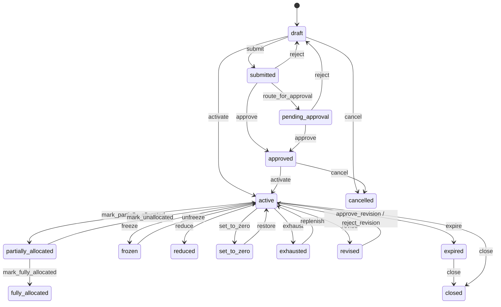
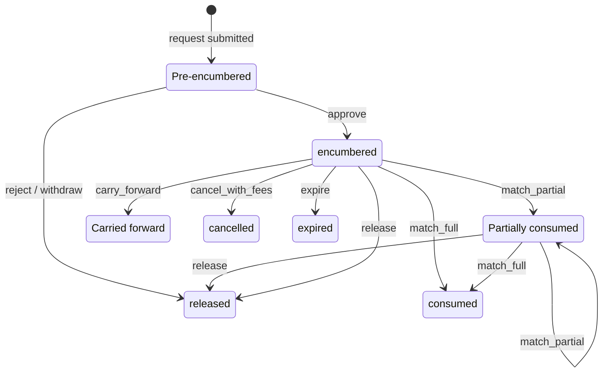
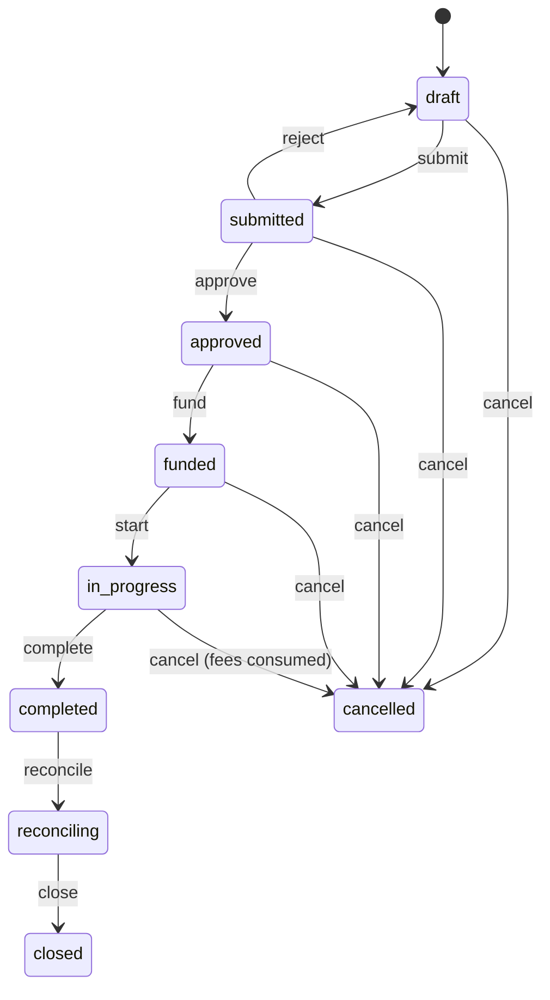
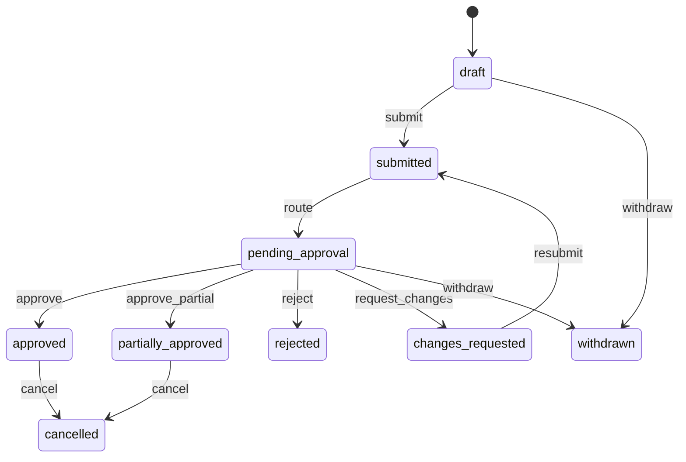
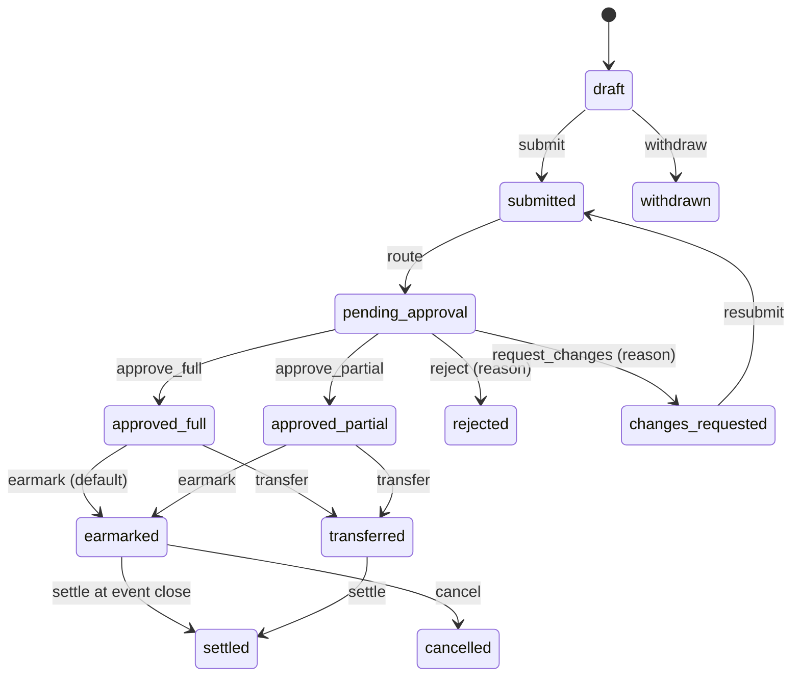
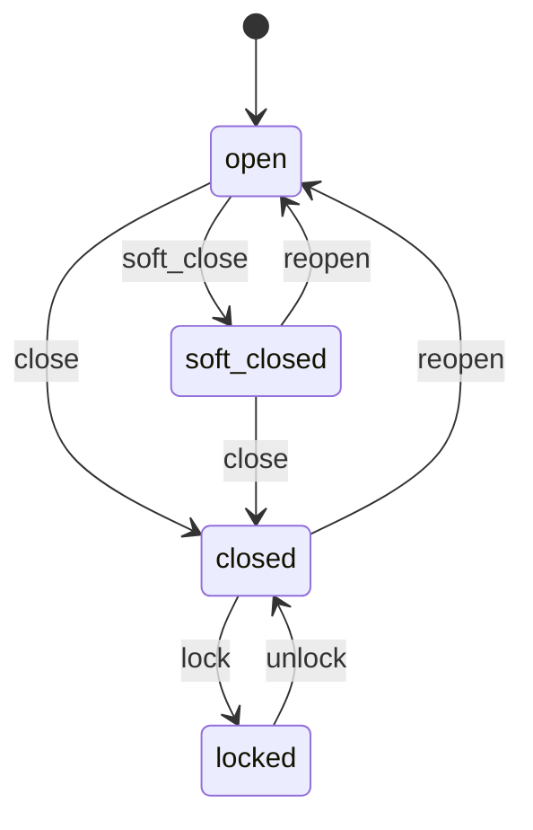
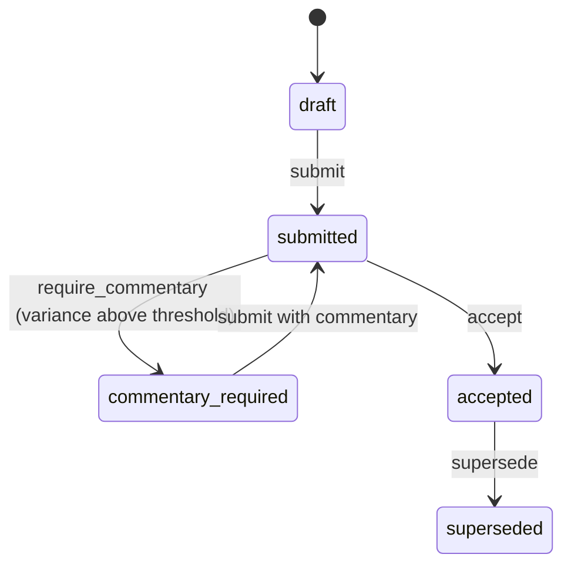
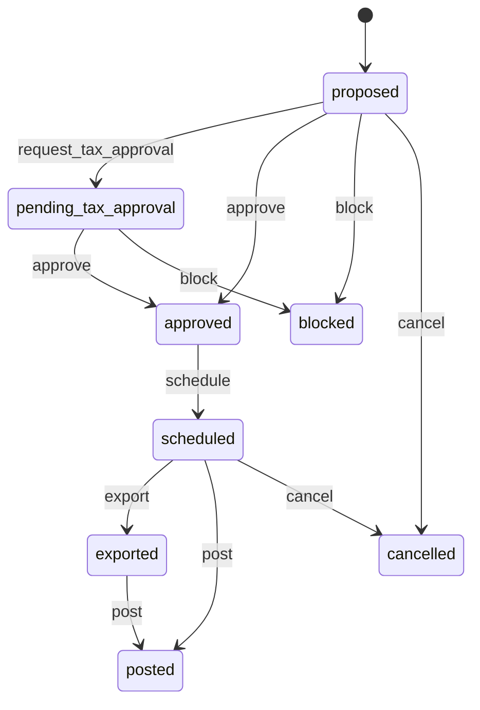

# State machines

Every lifecycle is a pure machine in `libs/domain` (`defineMachine`); an illegal event returns `INVALID_TRANSITION` with the allowed events. Guards that depend on balances or related records are separate domain functions, listed under each machine. The UI may show a subset of states; the machines are complete.

## Budget (15 states) — `budgetMachine`

Operating states (active, partially allocated, fully allocated, reduced) accept freeze, reduce, set to zero, exhaust, expire, close and revise; frozen and exhausted budgets can still be reduced, set to zero, expired and closed. Phase 1 creates budgets directly as `active`; Phase 4 adds the draft, submit and approve flow.

- `acceptsNewActivity(status)`: new requests, allocations and contributions are refused for frozen (`BUDGET_FROZEN`), set to zero (`BUDGET_SET_TO_ZERO`), exhausted, expired, closed, cancelled, and not-yet-active budgets. Phase 1 applies it to allocations.
- `allowsCommitmentCompletion(status)`: existing commitments complete under every control.
- `allocationBadge(authorized, allocatedOut)`: partially and fully allocated as computed badges.
- Reduce and set to zero: `previewReduction` / `validateReduction` (reason code, typed reason, destination, confirmed preview, floor = allocated out kept by children + held + encumbered + actual; pending requests listed but not floored; set to zero can cascade). Implemented in Phase 4 (`ControlsService`); every change publishes `budget.control_changed`.

## Commitment — `commitmentMachine`

Each transition posts a paired movement (`postCommitmentMovement`, see [ledger.md](ledger.md)).

## Event — `eventMachine`

Guards: `checkFundingCap` (own funds + contributions within estimate + tolerance), `canCloseEvent` (no unmatched actuals, no cross-entity contribution without its recharge), `surplusReturns` (by share, largest remainder).

## Request — `requestMachine`

Kinds: budget, spending, additional-fund, over-budget, exception. Approvers must pass `checkAuthority` (DoA limit for spend type and entity at the locked plan rate) and `checkApprovalHygiene` (no self-approval, not a beneficiary or attendee); delegates are capped by `delegatedLimit`.

## Inter-Director Budget Contribution Request — `contributionMachine`

The giving director decides (`decideContribution`): approve full, approve a different amount (more than zero, less than requested, within the giver's available), request changes or reject with a reason. Never automatic. Cross-entity contributions go through `resolveIntercompany` (block, recharge at cost, recharge with markup, tax approver).

## Accounting period — `periodMachine`

Reopen and unlock are privileged, reasoned and audited (Phase 11). Posting rules: [ledger.md](ledger.md#periods).

## Forecast snapshot — `forecastMachine`

Methods: run rate, committed + pipeline, owner input (Phase 11).

## Intercompany recharge — `rechargeMachine`

Posting: `postIntercompanyRecharge` (due from on the charging entity, due to on the charged entity; nets to zero at group level). Export to ERP is Phase 12.
