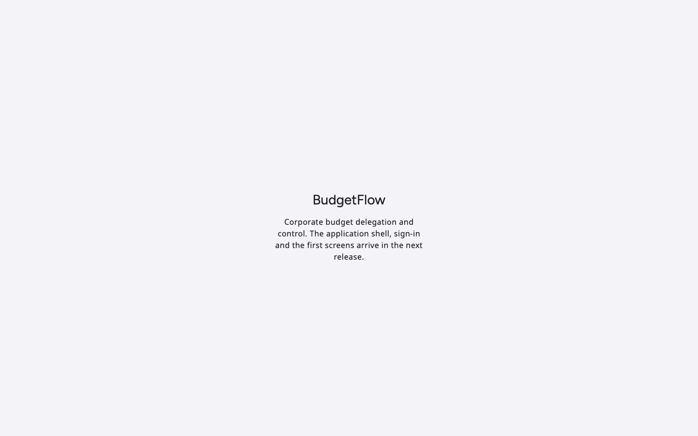

# p1-arch — gate review

- Commit: see `gate-summary.txt` (code commit reviewed) on `feat/p1-architecture`, reviewed 2026-11-04
- Scope: plan todo `p1-arch` (Nx workspace, docs, accounting-grade domain and ledger, schema and migrations, contracts, functional test harness, invariant-to-scenario map, screen inventory and role matrix); no product screens (Phase 2 builds the shell); journeys: placeholder smoke on desktop, tablet, mobile
- Result: passed with follow-ups — every gate passes locally and every Phase 1 invariant has a passing API scenario; reviewer subagents and the visual QA loop were not run (see Reviews). Phase 1 is a review stop for the user.

## Gates

| Gate                                                                                                  | Result                                                                                            | Evidence                                                 |
| ----------------------------------------------------------------------------------------------------- | ------------------------------------------------------------------------------------------------- | -------------------------------------------------------- |
| Secret scan                                                                                           | PASS                                                                                              | gate-summary.txt                                         |
| Lint (ESLint with Nx module boundaries, satori-lint on apps/web)                                      | PASS                                                                                              | gate-summary.txt                                         |
| Typecheck (13 projects plus both e2e projects)                                                        | PASS                                                                                              | gate-summary.txt                                         |
| Styles (stylelint, Satori adoption rules, no raw colors or font-family)                               | PASS                                                                                              | gate-summary.txt                                         |
| Build (api, worker, web; OpenAPI drift check; Drizzle drift and snapshot check)                       | PASS                                                                                              | gate-summary.txt                                         |
| Satori design system check (sdsc)                                                                     | PASS (version check informational: compares alpha.171 with the latest registry release)           | gate-summary.txt                                         |
| Local stack reset and deterministic seed                                                              | PASS                                                                                              | gate-summary.txt                                         |
| Functional API scenarios (apps/api-e2e)                                                               | PASS (56 scenarios)                                                                               | gate-summary.txt, ledger-invariants/functional/README.md |
| Functional journeys (apps/web-e2e)                                                                    | PASS (2 journeys x 3 viewports)                                                                   | gate-summary.txt                                         |
| Visual regression                                                                                     | SKIP — no approved screens yet (`apps/web-e2e/visual/screens.json` arrives with the first screen) | gate-summary.txt                                         |
| Harness validation (`sh scripts/validate-harness.sh`, incl. visual self-test 22/22, hook tests 99/99) | PASS                                                                                              | command output in the PR                                 |

## Acceptance checklist (plan's P1 gate)

| Criterion                                                                                                                                     | Proven by                                                                                                                                   | Role(s)                                                             | Result | Evidence                                                           |
| --------------------------------------------------------------------------------------------------------------------------------------------- | ------------------------------------------------------------------------------------------------------------------------------------------- | ------------------------------------------------------------------- | ------ | ------------------------------------------------------------------ |
| Docs: architecture, domain, API conventions, state machines, authorization matrix                                                             | `docs/architecture/*`, `docs/adr/*`                                                                                                         | –                                                                   | PASS   | docs/architecture/README.md                                        |
| OpenAPI generated from contracts, drift-checked                                                                                               | `contracts:openapi-check`; `health/health.spec.ts` (served document)                                                                        | –                                                                   | PASS   | gate-summary.txt                                                   |
| Functional harness running against the Compose stack                                                                                          | `apps/api-e2e`, `apps/web-e2e`, `scripts/gate.sh functional`                                                                                | all seeded roles                                                    | PASS   | ledger-invariants/functional/README.md                             |
| Unbalanced journals rejected                                                                                                                  | `ledger/available.spec.ts` (422 `JOURNAL_UNBALANCED`), `ledger/reversal.spec.ts` (database `BF003` at commit)                               | finance-admin, app role                                             | PASS   | ledger-invariants/functional/README.md                             |
| Corrections posted as reversals; ledger append-only                                                                                           | `ledger/reversal.spec.ts`                                                                                                                   | finance-controller, auditor, app role                               | PASS   | api/05-reversal.json                                               |
| Rebuilt balances equal cached ones; drift detected                                                                                            | `ledger/rebuild-check.spec.ts` (worker job)                                                                                                 | finance-controller, sandbox-admin                                   | PASS   | api/09-ledger-rebuild-check.json, db/rebuild-equals-cache.md       |
| Original budget, allocation at the locked plan rate, over-allocation rejected, idempotent retry, parallel allocations never exceed the parent | `ledger/original-budget.spec.ts`, `budgets/over-allocation.spec.ts`, `budgets/idempotency.spec.ts`, `budgets/concurrent-allocation.spec.ts` | ceo, regional-manager, auditor, employee                            | PASS   | api/01-04                                                          |
| Closed periods and late items                                                                                                                 | `ledger/closed-period.spec.ts`                                                                                                              | ceo, finance-controller, app role                                   | PASS   | api/06-late-posting-closed-period.json, db/seed-period-statuses.md |
| Tenant isolation (RLS, forged header) and director isolation                                                                                  | `scope/tenant-rls.spec.ts`, `db/rls-policies.spec.ts`, `scope/director-isolation.spec.ts`                                                   | ceo, globex-admin, regional-manager, budget-owner, location-manager | PASS   | api/07-08, db/rls-and-guards.md                                    |
| Hash-chained audit, one event per mutation, tamper detected                                                                                   | `audit/hash-chain.spec.ts`                                                                                                                  | auditor, sandbox-admin, app role                                    | PASS   | api/10-audit-verification.json                                     |
| Invariant-to-scenario map names a scenario and phase for every invariant                                                                      | `docs/testing/invariant-scenarios.md`                                                                                                       | –                                                                   | PASS   | 13 rows passing (4 of them Phase 1 part), 9 planned with phase     |
| Screen inventory with build phase per screen; role matrix                                                                                     | `docs/ux/screen-inventory.md`                                                                                                               | –                                                                   | PASS   | 124 specified + 86 review-added screens, every one assigned        |
| Phase handoff for parallel agents                                                                                                             | `docs/architecture/phase-handoff.md`                                                                                                        | –                                                                   | PASS   | owned paths, tables, contract files, seed hooks per phase          |

## Core acceptance scenario

Not run at Phase 1 (runs from the Wave 2 gate). Wave 1 setup data is seeded: 14 role users, Acme Global entities (US, India on an April-March calendar, Europe), FY2026 plan rates, org hierarchy, cost centers, DoA matrix and a headcount snapshot for Bengaluru and Hyderabad.

## Invariant coverage

`docs/testing/invariant-scenarios.md`: rows 1-8, 17-20 and 22 passing (2, 7, 8 and 22 for their Phase 1 part); rows 9-16 and 21 planned for Phases 4, 5, 6 and 13.

## Visual QA

Not run: Phase 1 has no product screens. The placeholder was checked by the smoke journey (no console errors or failed requests, Satori light theme applied) and by eye:

## Reviews

| Reviewer                  | Verdict                       | Blockers fixed | Remaining                                             |
| ------------------------- | ----------------------------- | -------------- | ----------------------------------------------------- |
| ux-reviewer               | not run (no screens in scope) | –              | run at the first UI phase                             |
| domain-invariant-reviewer | not run in this session       | –              | recommended before closing the Phase 1 review stop    |
| security review           | not run in this session       | –              | recommended (auth, RLS, secrets handling, CI changed) |

## Known issues

- The local registry token in `~/.npmrc` was rejected (HTTP 401) during this phase; dependencies were installed from the local npm cache at the pinned versions. CI installs from the registry with `SATORI_PACKAGES_TOKEN`. The owner should refresh the local token.
- `sdsc` reports Angular 22.2.4 and Satori alpha.171 as "non-compliant" because it compares with the latest Satori release; it is informational and exits 0.
- MinIO is pinned by digest to a Chainguard build because Docker Hub no longer serves `minio/minio` release tags ([ADR 0005](../../docs/adr/0005-container-images.md)).
- Phase 1 creates budgets directly as active; cost center is optional on all budgets until Phase 4.

## Open questions

- Confirm the role-action matrix defaults (`docs/architecture/authorization.md`), especially: org-admin without budget visibility, CEO allocating only within owned subtrees, finance-controller approving tenant-wide.
- Confirm the screen-to-phase assignments for the onboarding steps 6, 7 and 9 (Phase 3, because they need master data) and the audit log (Phase 5).

## Not in this pack

Traces, Playwright HTML reports, compose logs and raw run logs: `dist/.playwright/` and `tmp/` (local only).
