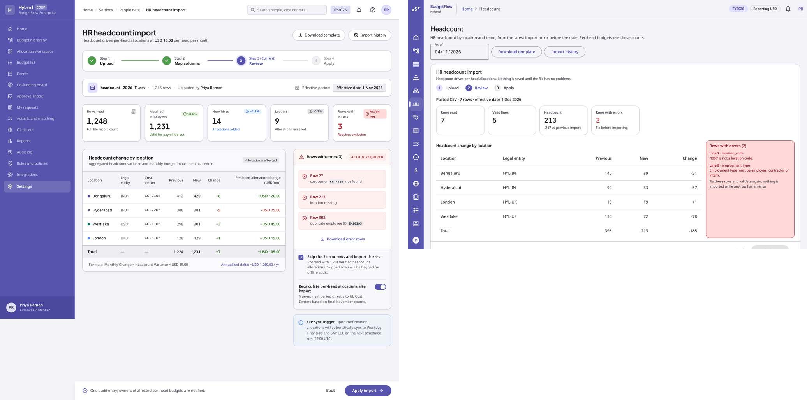
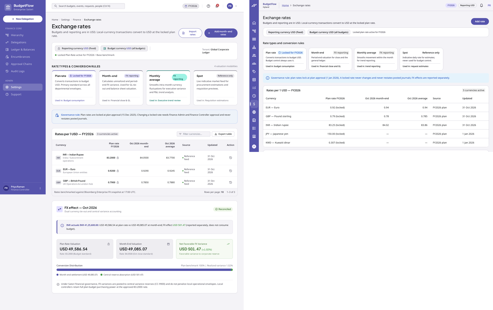
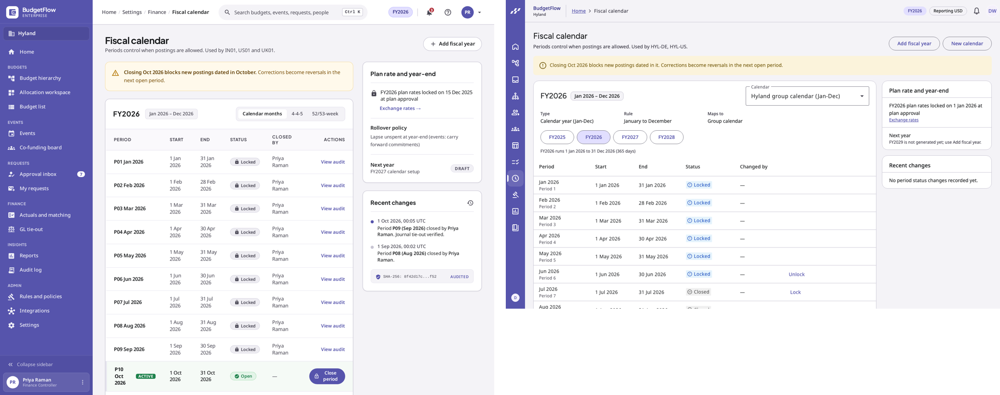

# Design parity — Phase 3 screens with Stitch designs

Three Phase 3 screens gained proposed Stitch designs on main during this phase (UX core set part 2, `docs/ux/review-log.md`: "proposed - awaiting user review"; implementation may build from proposed designs). Each image below is the design (left) next to the built page on the local stack with the deterministic seed (right), desktop, light theme. The other ten Phase 3 pages have no design yet.

## 022c HR headcount import

Matches: page purpose, step indicator (Upload, Review, Apply), file summary with effective date, KPI cards (rows read, valid lines, headcount with change, rows with errors in the error tone), "Headcount change by location" with legal entity, previous, new, change and a total row, an errors panel listing each bad row, Download template and Import history, and a footer with the audit note and Back / Apply import.

Accepted deviations (documented for design review):

- No "Map columns" step: Phase 3 uses one fixed CSV template (Download template).
- No per-head allocation change column or "recalculate per-head allocations" toggle: per-head rates and true-ups are Phase 4.
- No "skip the error rows and import the rest": imports are all-or-nothing (invariant 27); whether partial imports should be allowed is an open question for the design review.
- No new-hire and leaver cards: the HR file carries counts per location and team, not employee rows.
- No ERP sync note: integrations are Phase 12.

## 107 Exchange rates

Matches: title and subtitle, reporting and budget currency chips with the locked plan-rate note, the four rate-type tiles with their tags and uses, the governance banner, and "Rates per 1 USD — FY2026" with plan (locked), latest month-end, latest monthly average, source and updated.

Accepted deviations:

- One "Add rate" action instead of "Import rates" and "Add month-end rates" (rate feeds are Phase 12).
- The FX effect card is an interactive conversion (amount, currency, date, comparison type) instead of a fixed October example with a distribution bar; it shows plan valuation, the other valuation and the FX effect, reported separately.
- A plan-rate lock card (screen 107a) and a filterable rate history follow the matrix; export is Phase 10.

## 108 Fiscal calendar

Matches: title and subtitle naming the entities, the closing warning banner, the fiscal-year card with its date range, the periods table (period, start, end, status, changed by, actions with "Close period" as the primary action), and the right column with "Plan rate and year-end" (lock date, link to exchange rates, next year) and "Recent changes" from the audit trail with hashes.

Accepted deviations:

- A calendar picker replaces the "Calendar months / 4-4-5 / 52/53-week" segmented control: each legal entity's calendar is its own record (group Jan-Dec, India Apr-Mar, UK 4-4-5), so the picker switches calendars rather than views.
- No per-row "View audit" link; the audited changes appear in "Recent changes".
- No rollover-policy line (Phase 4 rollover policies, Phase 11 year-end).
- No separate "Future" status: periods are Open until closed (the domain has Open, Soft-closed, Closed, Locked).
